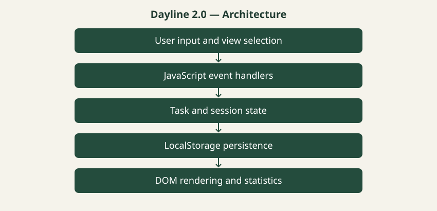

# Dayline 2.0

**Khushi Jain Daga | 23bcon1665 | Semester VII | JECRC University**

## Objective
Design an interactive web page using JavaScript, DOM manipulation and AI-generated scripts.

## Architecture

User input and view selection → JavaScript event handlers → Task and session state → LocalStorage persistence → DOM rendering and statistics

## Technologies
HTML5, CSS3, vanilla JavaScript. AI assistance: ChatGPT.

## Implementation
Five views: Overview, My Tasks, Board, Calendar and Focus. Add, edit, duplicate, delete, complete, filter and sort tasks; categories and deadlines; Kanban drag and drop plus status selectors; seven-day completion counts; 25-minute focus and 5-minute break timer; theme and JSON backup. The study suggestion is rule-based. Timer sessions are recorded when completed; an active timer does not survive reload.

## Run locally
Open a terminal in this folder and run `python -m http.server 8002`. Visit http://localhost:8002. No dependencies or API keys.

## AI development brief
Build an original responsive Dayline 2.0 project implementing the objective and features above, with visible student attribution.

## Verification
JavaScript syntax check passed. Automated browser navigation was blocked by the environment; functional and visual tests remain pending. Capture genuine screenshots after local execution.

## Acceptance tests
- Create, edit, duplicate, delete and complete a task.
- Search, sort and filter; move a task across board lanes.
- Verify calendar deadlines, timer controls, theme and reload persistence.
- Export and import a backup.
- Check layout at 390px and 1440px.

## Conclusion
The implementation demonstrates the required client-side web development concepts. Final verification is pending.
